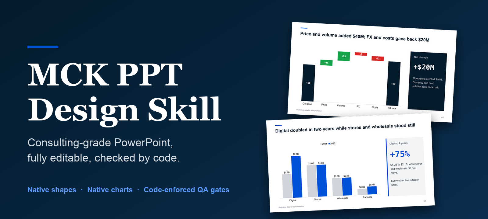
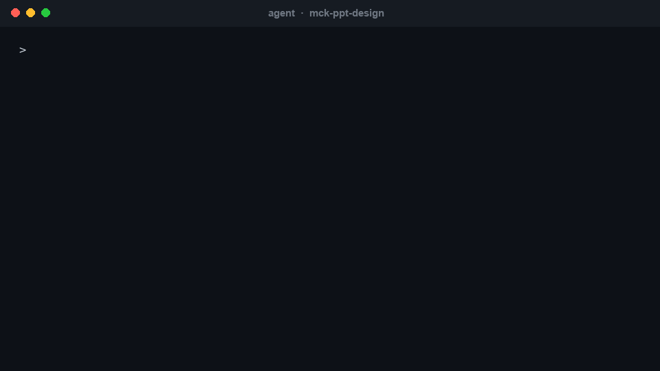
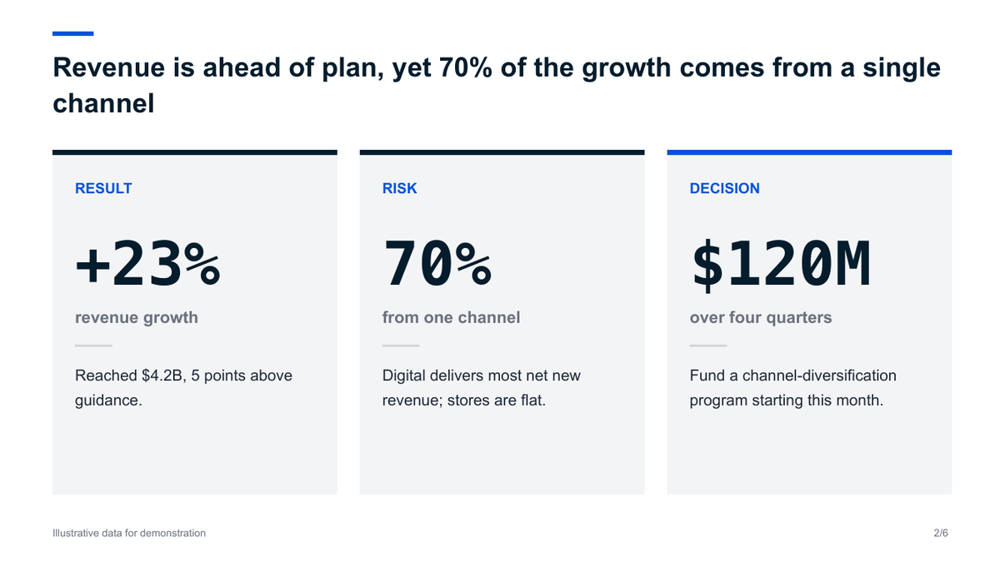
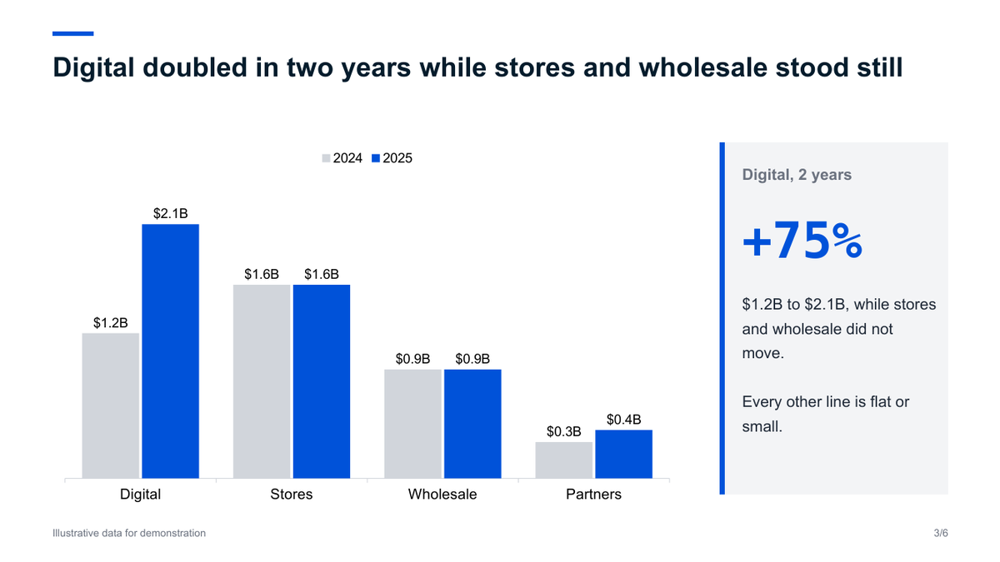
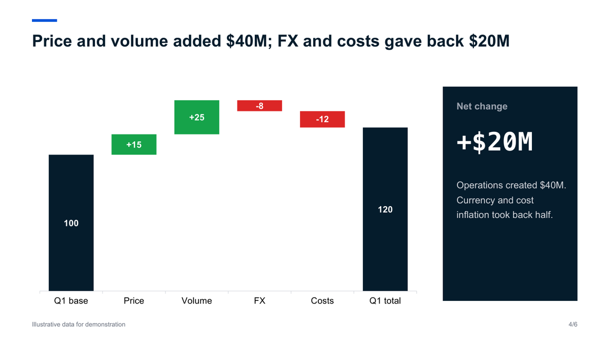
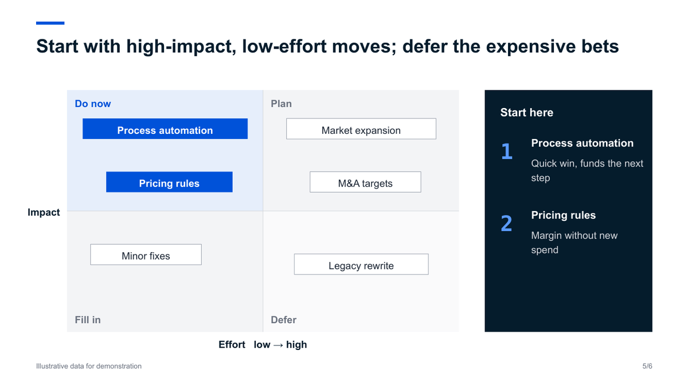
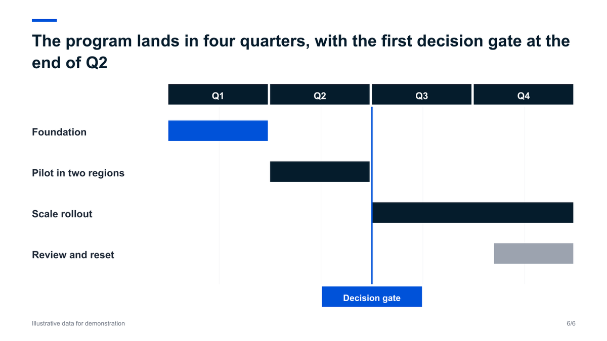
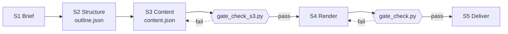

<div align="center">



<br/>

[](https://github.com/likaku/Mck-ppt-design-skill/stargazers)
[](https://github.com/likaku/Mck-ppt-design-skill/network/members)
[](LICENSE)
[](https://python.org)

**[Try it in 60 seconds](#-try-it-in-60-seconds)** · **[Use with your agent](#-use-it-with-your-agent)** · **[Gallery](docs/GALLERY.md)** · **[简体中文](README.zh-CN.md)** · **[Architecture](docs/ARCHITECTURE.md)**

</div>

<br/>

> **Your AI agent writes the story. This skill draws the deck and checks the file.**
> The output is a real `.pptx`: native shapes, native charts, every element editable in PowerPoint, WPS or Keynote.

<div align="center">

<br/><sub>Prompt to deck. The slides and the gate result are real output; the terminal is a recreation. Data in the slides is illustrative.</sub>
</div>

<br/>

## What the output looks like

<table>
<tr>
<td width="33%"></td>
<td width="33%"></td>
<td width="33%"></td>
</tr>
<tr>
<td align="center"><sub><b>Cover</b><br/>numbers carry the story</sub></td>
<td align="center"><sub><b>Executive summary</b><br/>result, risk, decision</sub></td>
<td align="center"><sub><b>Native chart</b><br/>click it, edit the data</sub></td>
</tr>
<tr>
<td width="33%"></td>
<td width="33%"></td>
<td width="33%"></td>
</tr>
<tr>
<td align="center"><sub><b>Waterfall</b><br/>native stacked column</sub></td>
<td align="center"><sub><b>Prioritisation</b><br/>items placed by judgement</sub></td>
<td align="center"><sub><b>Roadmap</b><br/>with a decision gate</sub></td>
</tr>
</table>

<sub>All six slides come from [`examples/freeform_showcase.py`](examples/freeform_showcase.py), rendered with LibreOffice. Data is illustrative. Fonts differ slightly in PowerPoint.</sub>

## Why this exists

Ask an agent for a deck and you usually get text boxes on a white page, or a picture you cannot edit. This skill gives the agent a third path.

| | |
|---|---|
| **Real, editable `.pptx`** | Native shapes, text and charts. No screenshots. Change a number in the chart's data sheet and the bars move. |
| **Consulting grammar built in** | Action titles that state the conclusion, a source line on every slide, restrained navy and grey, flat design. |
| **The agent decides, Python draws** | `eng.donut(...)` costs the agent about 20 tokens; deterministic code does the rest. The author measured a 30-slide deck dropping from 40,000-60,000 output tokens to 9,000-12,000 in the v1 to v2 rewrite. |
| **A gate that is code, not opinion** | `gate_check.py` writes `gate_result.json`. `passed` is computed by the script, so the agent cannot declare its own work done. It catches overflow, out-of-bounds shapes, font inconsistency and legend overflow. It does **not** catch every visual flaw: render and look before you ship. |
| **Files that open cleanly** | No connectors, shadows or 3D; the post-save cleanup removes the XML that triggers PowerPoint's "repair" prompt. |
| **CJK aware** | An East Asian font (KaiTi by default) is written on every text run so Chinese does not fall back to boxes where that font is installed. |

## 🚀 Try it in 60 seconds

No API key, no network. Needs Python 3.8+.

```bash
pip install "git+https://github.com/likaku/Mck-ppt-design-skill.git"
python -m mck_ppt demo        # writes mck_demo.pptx (13 slides, passes the built-in check)
python -m mck_ppt layouts     # lists every layout with a one-line description
```

Then the freeform example that produced the slides above:

```bash
git clone https://github.com/likaku/Mck-ppt-design-skill && cd Mck-ppt-design-skill
python examples/freeform_showcase.py out.pptx
python references/scripts/gate_check.py out.pptx .     # writes gate_result.json
```

> The gate scripts live in `references/scripts/` and are not part of the pip package; clone the repo to use them.

## 🤖 Use it with your agent

| Agent | How |
|---|---|
| **Claude Code** | `git clone https://github.com/likaku/Mck-ppt-design-skill ~/.claude/skills/mck-ppt-design` and `pip install python-pptx lxml` |
| **WorkBuddy / CodeBuddy** | Search `mck-ppt-design` in the skill market, or clone into `~/.workbuddy/skills/mck-ppt-design` |
| **Cursor / Continue / any LLM** | Add `SKILL.md` as a project rule or paste it as context, and `pip install` the package |

Then ask in plain language:

> Make a 12-slide board deck on why our Q1 growth now depends on one channel. Action titles, one chart per argument, a source line on every slide.

> 用麦肯锡风格做一份 15 页的年度战略汇报：先给执行摘要，再分三章，最后列出需要决策的四件事。

The agent follows five stages, and two of the gates are scripts it cannot argue with:



Details in [docs/HARNESS.md](docs/HARNESS.md).

## Two ways to build a deck

| | **Layout methods** | **Free composition** |
|---|---|---|
| What | `eng.cover()`, `eng.table_insight()`, `eng.donut()` and 59 more | Drawing primitives and native charts, as in `examples/freeform_showcase.py` |
| Strength | Fast, consistent, hard to break | More visual: big numbers, native charts, custom composition |
| Risk | Fixed text boxes: long text overflows, the layout cannot bend | Needs a render-and-look pass; there is no template to lean on |
| Use when | Many slides, tight deadline, uniform look | The deck has to persuade, or a layout does not fit the message |

Both go through the same cleanup and the same gate. In our own tests the free-composition version of the same content looked clearly better; the layout version is faster.

```python
from mck_ppt import MckEngine
from mck_ppt.constants import *

eng = MckEngine(total_slides=3)
eng.cover(title='Q1 strategy review', subtitle='Board presentation', date='2026')
eng.table_insight(
    title='Three shifts are restructuring the market',
    headers=['Dimension', 'Before', 'After'],
    rows=[['Distribution', 'Offline-first', 'Digital-first'], ['Pricing', 'Cost-plus', 'Value-based']],
    insights=['Digital channels now drive 60% of acquisition', 'Value pricing unlocks about 3x margin'])
eng.closing(title='Thank you')
eng.save('deck.pptx')
```

<details>
<summary><b>All 62 layout methods</b></summary>

<br/>

| Category | Layouts |
|---|---|
| **Structure** | `cover`, `section_divider`, `toc`, `agenda`, `appendix_title`, `closing` |
| **Key numbers** | `big_number`, `two_stat`, `three_stat`, `metric_cards`, `scorecard`, `kpi_tracker`, `rag_status`, `data_table`, `harvey_ball_table` |
| **Frameworks** | `table_insight`, `matrix_2x2`, `pyramid`, `process_chevron`, `temple`, `swot`, `value_chain`, `risk_matrix`, `stakeholder_map`, `decision_tree` |
| **Comparison** | `side_by_side`, `before_after`, `pros_cons`, `metric_comparison` |
| **Narrative** | `executive_summary`, `key_takeaway`, `four_column`, `two_column_text`, `case_study`, `action_items`, `checklist`, `quote`, `meet_the_team`, `numbered_list_panel`, `icon_grid` |
| **Timeline** | `timeline`, `vertical_steps` |
| **Charts** | `donut`, `waterfall`, `line_chart`, `pareto`, `bubble`, `grouped_bar`, `stacked_bar`, `horizontal_bar`, `stacked_area`, `multi_bar_panel`, `dashboard_kpi_chart`, `dashboard_table_chart` |
| **Image layouts** | `content_right_image`, `three_images`, `image_four_points`, `full_width_image`, `case_study_image`, `quote_bg_image`, `goals_illustration`, `two_col_image_grid` |

Signatures: `python -m mck_ppt layouts`, or [docs/GALLERY.md](docs/GALLERY.md).

</details>

<details>
<summary><b>Guard rails enforced in code</b></summary>

<br/>

- No connectors (they trigger PowerPoint repair prompts); lines are thin rectangles.
- Shadows, 3D and `p:style` are stripped after save.
- Same-row shapes keep the same font size; text never touches separator lines.
- Circular charts use native `BLOCK_ARC`, 3-4 shapes instead of thousands of rectangles.
- Every CJK run gets an East Asian font.

Full list: [docs/ARCHITECTURE.md](docs/ARCHITECTURE.md).

</details>

<details>
<summary><b>Known limitations (read before you rely on it)</b></summary>

<br/>

- **Gate is not a visual review.** It misses some problems, for example a long title that wraps onto the subtitle. Render the deck and look at it.
- **Layout methods use fixed text boxes.** Long text overflows; some layouts are sparse (for instance `big_number`).
- **Preview needs LibreOffice.** `scripts/render_preview.py` uses LibreOffice and poppler. Install KaiTi and Arial for faithful output; without KaiTi the text falls back to another font and wrapping changes.
- **Not supported:** SmartArt, animations, slide masters.
- **Layout QA is not clean yet.** `python run_qa_tests.py` still reports layout errors on several layouts; they are tracked for v2.4.x.
- **AI cover image** needs a Tencent Cloud key and extra dependencies (`pip install ...[cover-image]`).

</details>

<details>
<summary><b>FAQ</b></summary>

<br/>

**Does it open in WPS and Keynote?** The file uses standard shapes and charts. We test mainly in PowerPoint and LibreOffice; please open an issue if you see differences.

**Chinese text looks different from the screenshots.** The default East Asian font is KaiTi. If it is not installed, your viewer substitutes another font. Install KaiTi, or change the font in `mck_ppt/constants.py`.

**Can I change the colors?** Yes. Palette constants are in `mck_ppt/constants.py`.

**Do I need an API key?** No, except for the optional AI cover image.

</details>

## Roadmap

- [x] `python -m mck_ppt demo`, `layouts`, `pip install` from GitHub
- [x] Free-composition example with native charts
- [ ] Publish to PyPI (`pip install mck-ppt`)
- [ ] Render-and-check step in the gate (catch text overlapping other shapes)
- [ ] Native chart helpers in the engine (clustered, stacked, waterfall)
- [ ] Theme switch (navy / graphite / warm)
- [ ] Import an existing `.pptx` and restyle it

Want something? [Request a layout](https://github.com/likaku/Mck-ppt-design-skill/issues/new?template=layout_request.yml) · [Show a deck you built](https://github.com/likaku/Mck-ppt-design-skill/issues/new?template=showcase.yml)

## Community

- **Made a deck with it?** [Show it](https://github.com/likaku/Mck-ppt-design-skill/issues/new?template=showcase.yml). Good ones get featured here.
- **Bug or broken layout?** [Open an issue](https://github.com/likaku/Mck-ppt-design-skill/issues/new?template=bug_report.yml) with the layout name, a 5-line repro and a screenshot.
- **Chat:** [Discord](https://discord.gg/SaFybFAT) · WeChat group (200+ members): add `Kashinmoto`
- **Contribute:** see [CONTRIBUTING.md](CONTRIBUTING.md)

If it saved you an evening, a star helps other people find it.

<div align="center">

[](https://star-history.com/#likaku/Mck-ppt-design-skill&Date)

</div>

---

<div align="center"><sub>Apache 2.0 · © 2024-2026 <strong>Kaku Li</strong> · <a href="NOTICE">NOTICE</a> · <a href="CHANGELOG.md">Changelog</a></sub></div>
