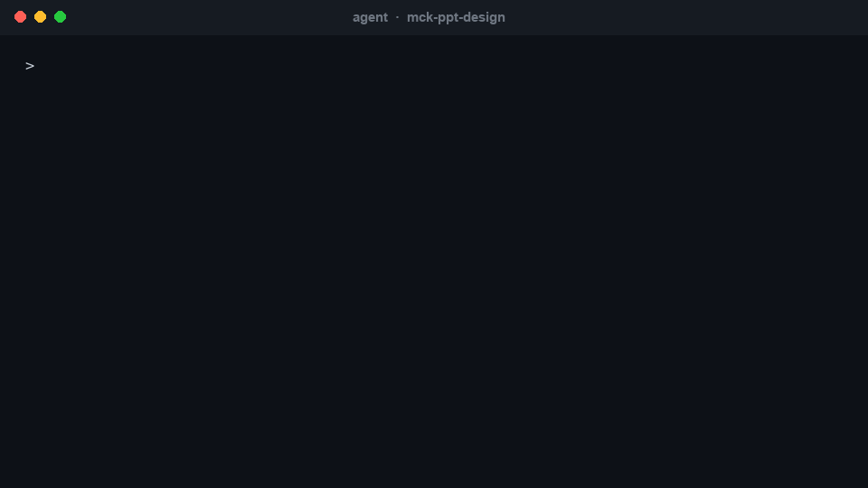
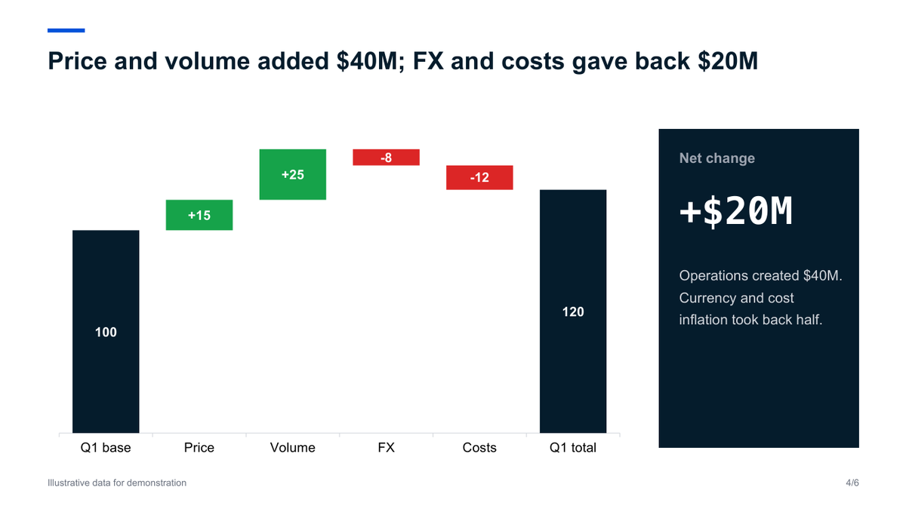
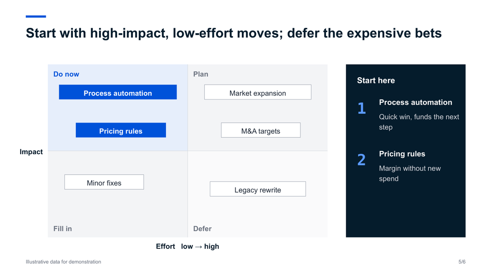
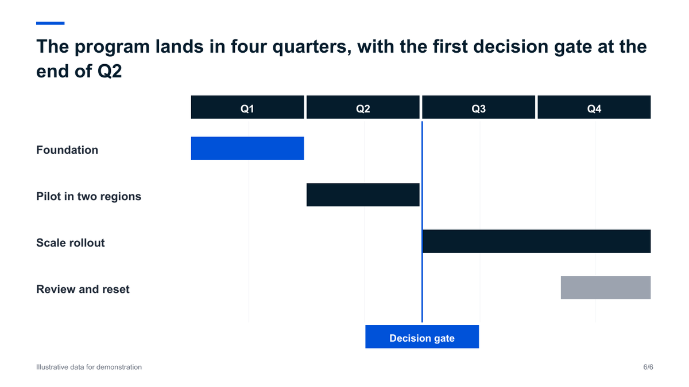

<div align="center">


<br/>

[](https://github.com/likaku/Mck-ppt-design-skill/stargazers)
[](https://github.com/likaku/Mck-ppt-design-skill/network/members)
[](LICENSE)

**[60 秒试用](#-60-秒试用)** · **[在智能体里使用](#-在智能体里使用)** · **[版式清单](docs/GALLERY.md)** · **[English](README.md)**

</div>

<br/>

> **智能体负责讲清楚故事，这个 skill 负责把 PPT 画出来，并检查文件。**
> 输出是真正的 `.pptx`：原生形状、原生图表，每个元素在 PowerPoint、WPS、Keynote 里都能改。

<div align="center">

<br/><sub>一句话到成品。幻灯片和门禁结果是真实输出，终端画面为复现；页内数据均为示例。</sub>
</div>

<br/>

## 成品长什么样

<table>
<tr>
<td width="33%"></td>
<td width="33%"></td>
<td width="33%"></td>
</tr>
<tr>
<td align="center"><sub><b>封面</b><br/>用数字讲故事</sub></td>
<td align="center"><sub><b>执行摘要</b><br/>结果、风险、决策</sub></td>
<td align="center"><sub><b>原生图表</b><br/>点开就能改数据</sub></td>
</tr>
<tr>
<td width="33%"></td>
<td width="33%"></td>
<td width="33%"></td>
</tr>
<tr>
<td align="center"><sub><b>瀑布图</b><br/>原生堆叠柱实现</sub></td>
<td align="center"><sub><b>优先级矩阵</b><br/>按判断摆位</sub></td>
<td align="center"><sub><b>路线图</b><br/>带决策节点</sub></td>
</tr>
</table>

<sub>六页均由 [`examples/freeform_showcase.py`](examples/freeform_showcase.py) 生成，用 LibreOffice 渲染。数据为示例；在 PowerPoint 中字体略有差异。</sub>

## 它解决什么问题

让 AI 做 PPT，常见结果是白底上堆文字框，或者一张改不了的图片。这个项目给出第三种做法：

| | |
|---|---|
| **真正可编辑的 `.pptx`** | 原生形状、文字和图表，不是截图。改图表数据，柱子会跟着动。 |
| **内置咨询文法** | 标题写结论、每页有来源行、深蓝加灰的克制配色、扁平无阴影。 |
| **智能体决策，Python 绘制** | `eng.donut(...)` 智能体只花约 20 个 token，其余由确定性代码完成。作者实测 30 页 PPT 的输出从 4 到 6 万 token 降到 0.9 到 1.2 万（v1 到 v2 重写时）。 |
| **门禁是代码，不是口头判断** | `gate_check.py` 写出 `gate_result.json`，`passed` 由脚本算出，智能体不能自己宣布通过。它能查出文字溢出、元素越界、字体不一致、图例溢出；**查不全所有视觉问题**，交付前请渲染后亲眼看一遍。 |
| **文件能干净打开** | 不用连接线、阴影、3D；保存后清理会触发 PowerPoint"修复"提示的 XML。 |
| **照顾中文** | 每段文字都写入东亚字体（默认楷体）；本机装有该字体时，中文不会退化成方块。 |

## 🚀 60 秒试用

不需要 API Key，不需要联网，需要 Python 3.8+。

```bash
pip install "git+https://github.com/likaku/Mck-ppt-design-skill.git"
python -m mck_ppt demo        # 生成 mck_demo.pptx，13 页，通过内置检查
python -m mck_ppt layouts     # 列出全部版式
```

再运行上面成品图用的自由构图示例：

```bash
git clone https://github.com/likaku/Mck-ppt-design-skill && cd Mck-ppt-design-skill
python examples/freeform_showcase.py out.pptx
python references/scripts/gate_check.py out.pptx .     # 写出 gate_result.json
```

> 门禁脚本在 `references/scripts/`，不在 pip 包里，需要克隆仓库才能用。

## 🤖 在智能体里使用

| 智能体 | 方式 |
|---|---|
| **Claude Code** | `git clone https://github.com/likaku/Mck-ppt-design-skill ~/.claude/skills/mck-ppt-design`，并 `pip install python-pptx lxml` |
| **WorkBuddy / CodeBuddy** | 在 skill 市场搜索 `mck-ppt-design`，或克隆到 `~/.workbuddy/skills/mck-ppt-design` |
| **Cursor / Continue / 任意大模型** | 把 `SKILL.md` 作为项目规则或上下文，并安装本包 |

然后直接用中文提需求：

> 用麦肯锡风格做一份 15 页的年度战略汇报：先给执行摘要，再分三章，最后列出需要决策的四件事。每页标题写结论，每页有数据来源。

智能体按五个阶段工作，其中两道门禁是脚本：需求、结构（`outline.json`）、内容（`content.json`，过 `gate_check_s3.py`）、渲染（过 `gate_check.py`）、交付。详见 [docs/HARNESS.md](docs/HARNESS.md)。

## 两种做法

| | **版式方法** | **自由构图** |
|---|---|---|
| 是什么 | `eng.cover()`、`eng.table_insight()`、`eng.donut()` 共 62 个方法 | 底层绘制加原生图表，见 `examples/freeform_showcase.py` |
| 优点 | 快、统一、不容易出错 | 视觉更强：大数字、原生图表、自定义构图 |
| 风险 | 文本框固定，长文字会溢出，版式不能变形 | 必须渲染后目检，没有模板兜底 |
| 适合 | 页数多、赶时间、要统一外观 | 需要说服人，或版式不贴合要讲的内容 |

两种做法经过同样的清理和同一道门禁。我们自己对同一份内容做过对比，自由构图版明显更好看；版式方法更快。

## 已知局限（依赖它之前请先看）

- **门禁不等于视觉检查。** 它会漏掉一些问题，比如过长的标题折行后压住副标题。请渲染后亲眼看。
- **版式方法的文本框是固定的。** 长文字会溢出，个别版式偏空（如 `big_number`）。
- **预览需要 LibreOffice。** `scripts/render_preview.py` 依赖 LibreOffice 和 poppler；没装楷体时会换字体，折行会不同。
- **不支持**：SmartArt、动画、母版。
- **版式质检尚未清零。** `python run_qa_tests.py` 仍有若干版式报错，计划在 v2.4.x 处理。

## 参与

- **用它做了 PPT？** [发出来看看](https://github.com/likaku/Mck-ppt-design-skill/issues/new?template=showcase.yml)，好的会放进 README。
- **缺版式或发现问题？** [提需求](https://github.com/likaku/Mck-ppt-design-skill/issues/new?template=layout_request.yml) / [报 Bug](https://github.com/likaku/Mck-ppt-design-skill/issues/new?template=bug_report.yml)。
- **交流：** 微信群（200 多人）加微信 `Kashinmoto`；[Discord](https://discord.gg/SaFybFAT)。

如果它帮你省了一个晚上，点个 Star，能让更多人搜到它。

<div align="center">

[](https://star-history.com/#likaku/Mck-ppt-design-skill&Date)

</div>

---

<div align="center"><sub>Apache 2.0 · © 2024-2026 <strong>Kaku Li</strong></sub></div>
