# Layout gallery

> Back to [README](../README.md)

## Free-composition examples

Drawn with primitives and native charts (`examples/freeform_showcase.py`). Illustrative data.

| | | |
|---|---|---|
|  | 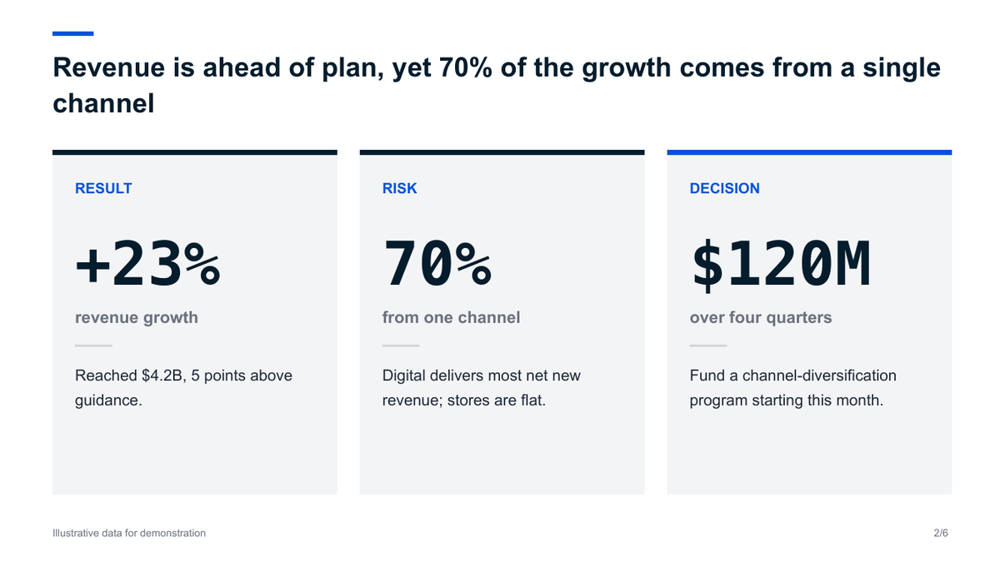 | 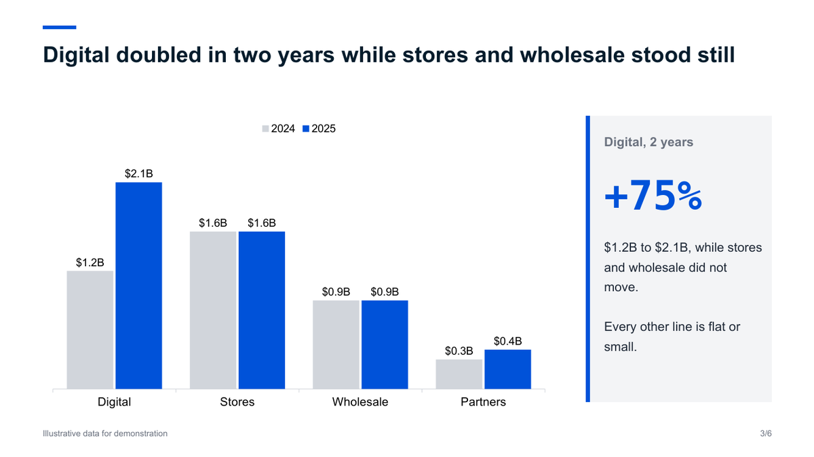 |
| 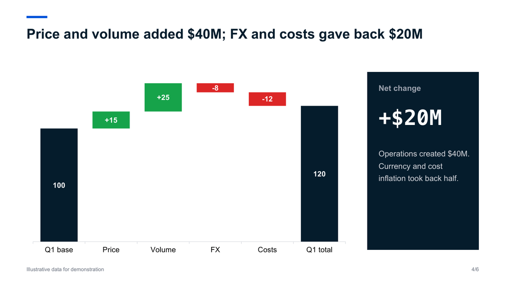 | 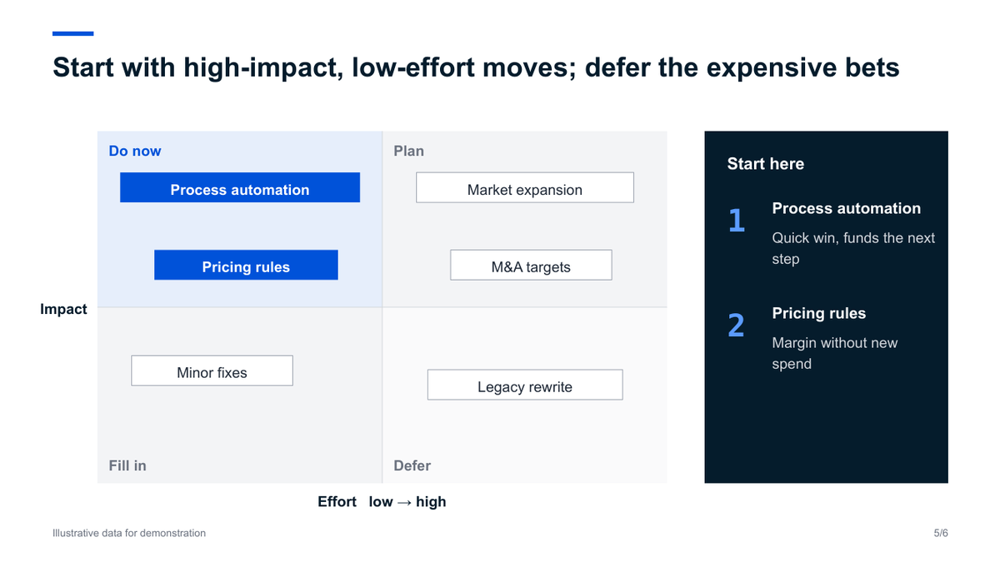 | 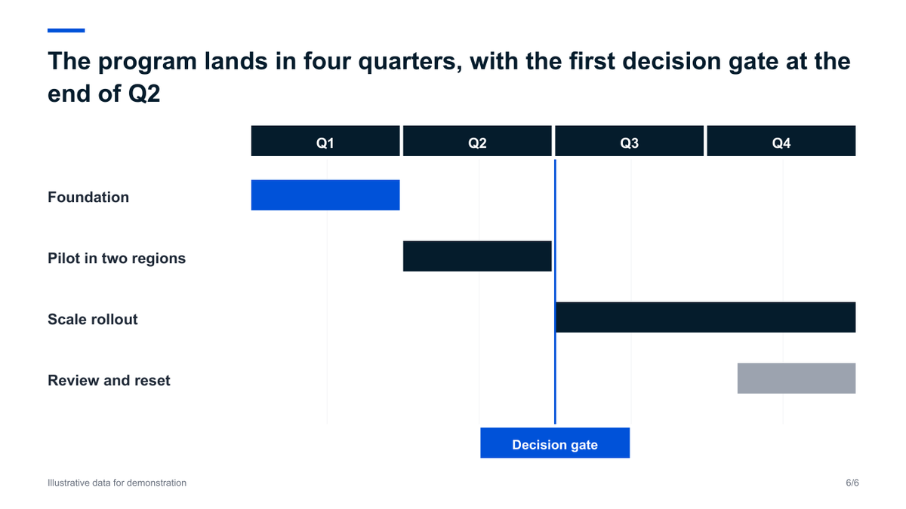 |

## Layout-method demo (`python -m mck_ppt demo`)

These 13 slides use the fixed layout methods. They are consistent and fast, but plainer than the examples above; some are sparse (see known limitations in the README).

| | | |
|---|---|---|
| 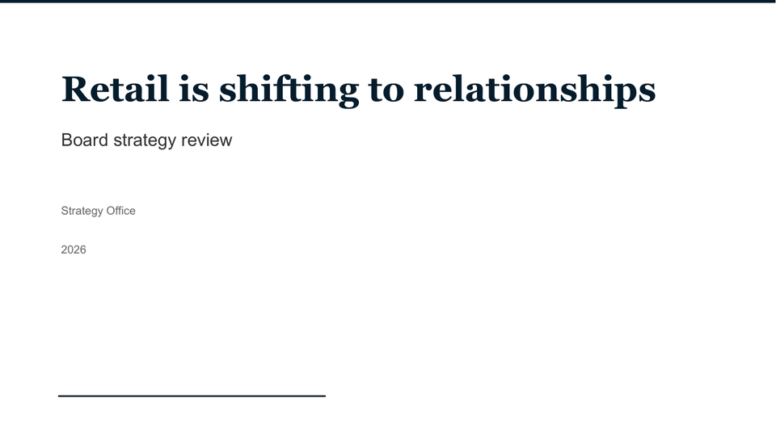 | 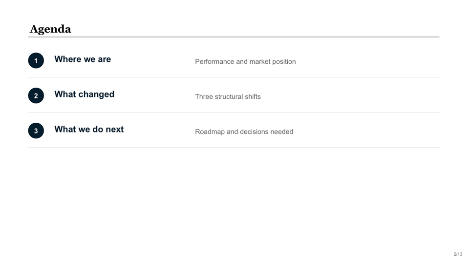 | 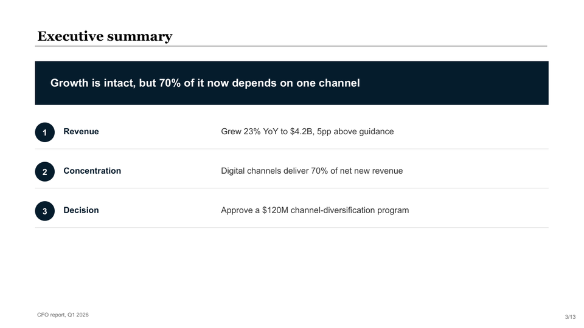 |
| 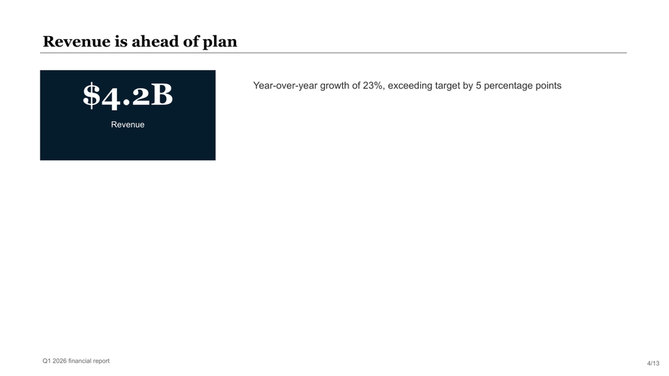 | 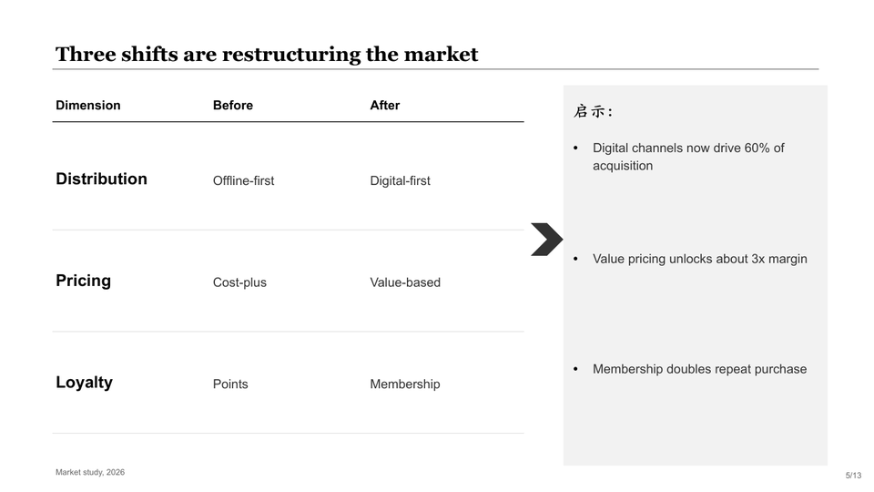 | 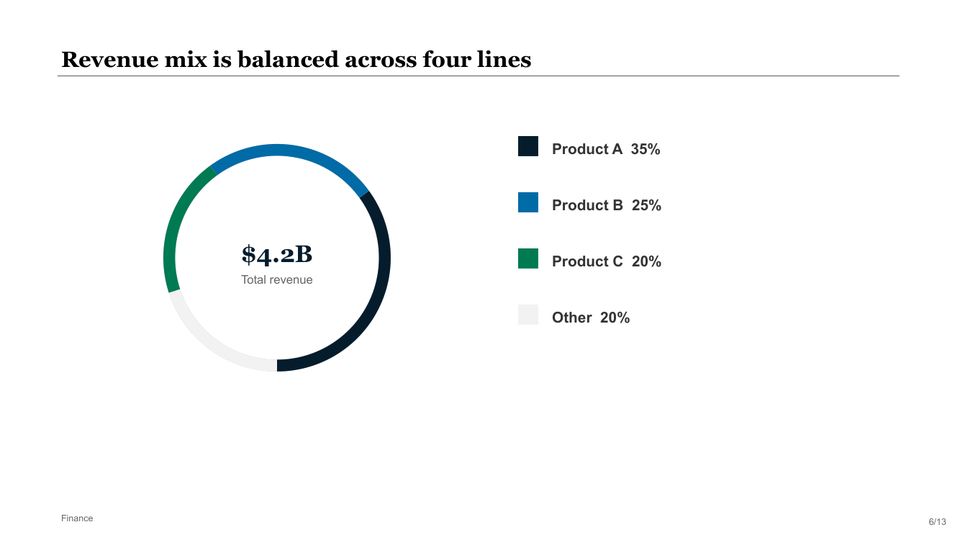 |
| 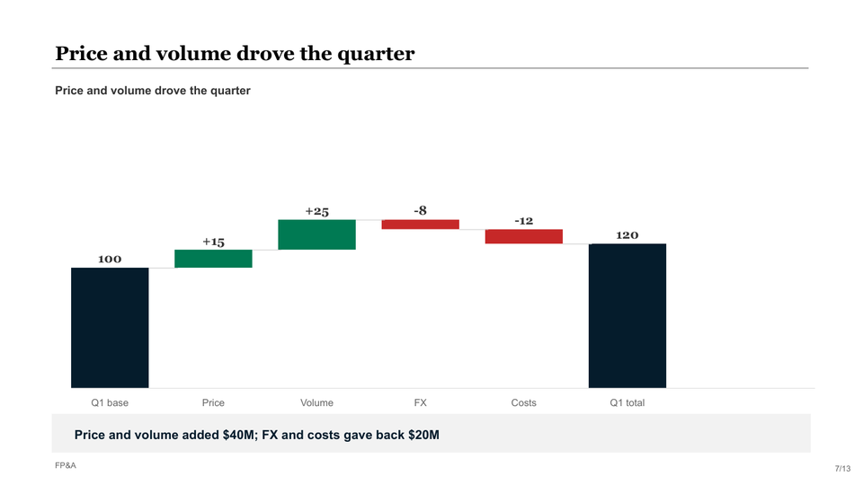 | 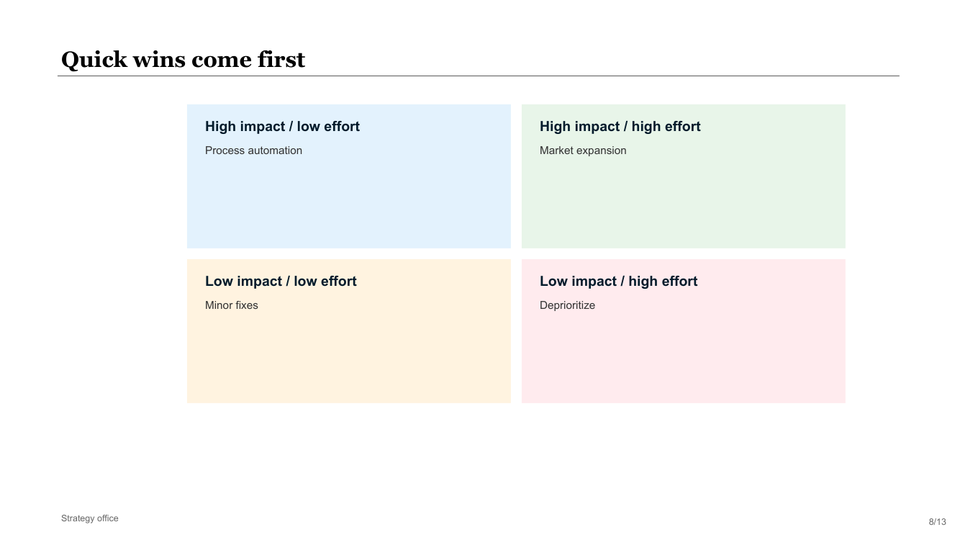 | 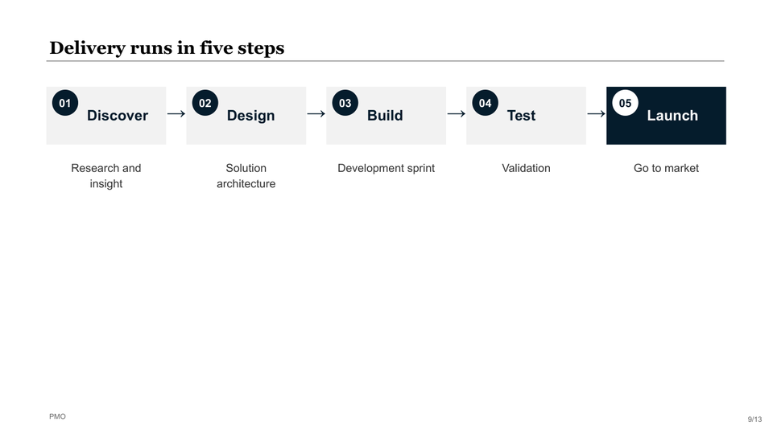 |
| 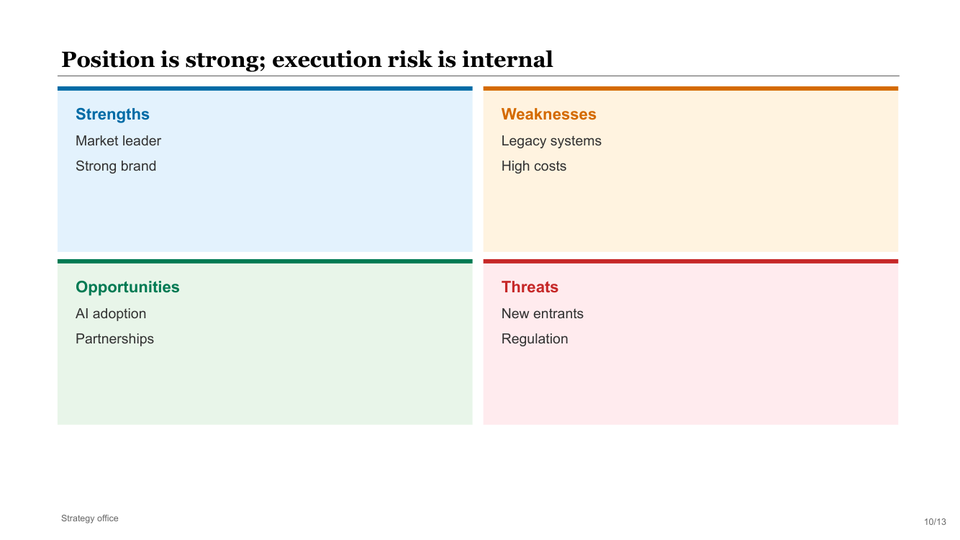 | 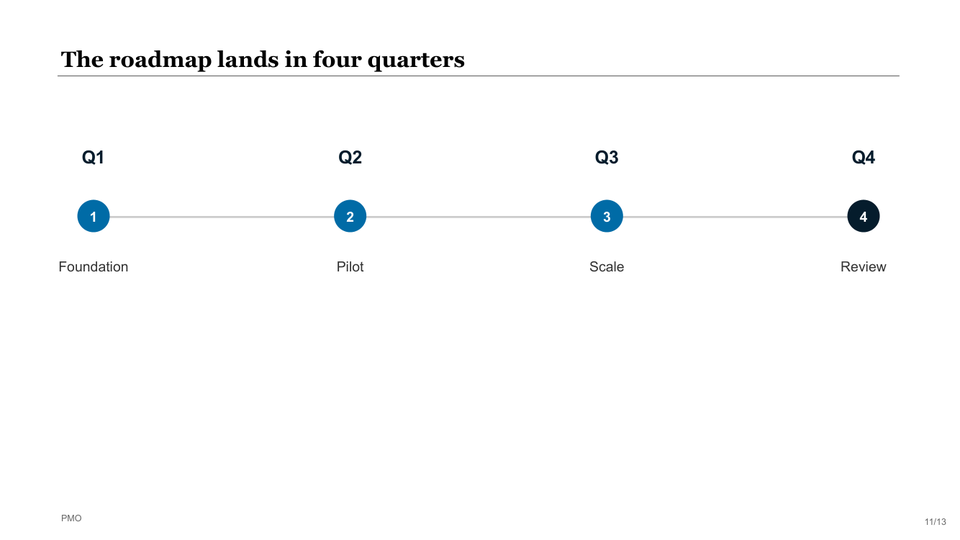 | 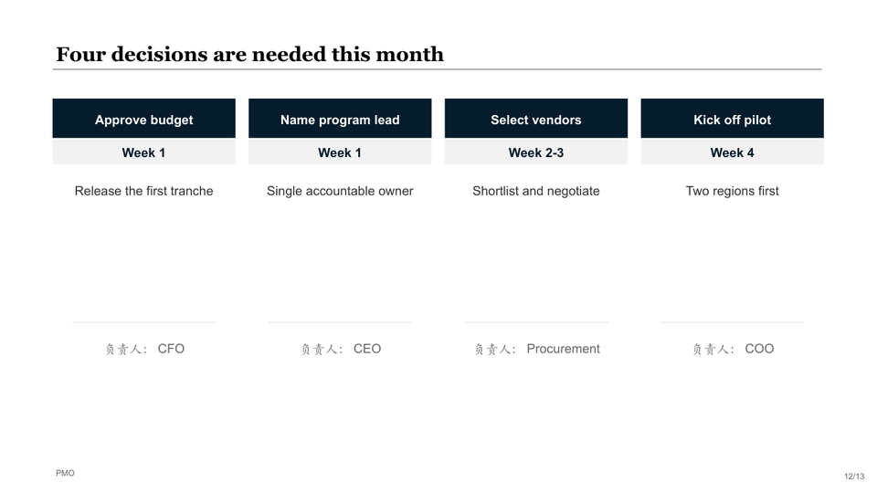 |
| 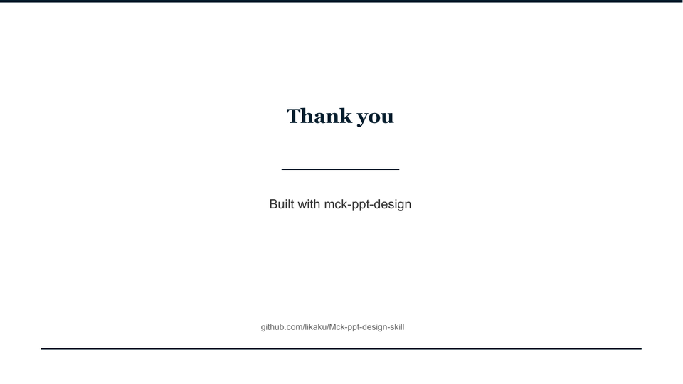 |  |  |

## All layout methods

62 active layouts. Generated from the engine by `python -m mck_ppt layouts --json`.

## Structure

| Method | What it is | Signature |
|---|---|---|
| `cover` | #1 Cover Slide — title, subtitle, author, date, accent line. | `cover(title, subtitle='', author='', date='', cover_image=None)` |
| `section_divider` | #5 Section Divider — navy left bar, large title. | `section_divider(section_label, title, subtitle='')` |
| `toc` | #6 Table of Contents — numbered items with descriptions. | `toc(title='目录', items=None, source='')` |
| `agenda` | #66 Agenda — table-style meeting agenda. | `agenda(title, headers, items, footer_text='', source='')` |
| `appendix_title` | #7 Appendix Title — centered title with accent lines. | `appendix_title(title, subtitle='')` |
| `closing` | #36 Closing / Thank You slide. | `closing(title, message='', source_text='')` |

## Key numbers

| Method | What it is | Signature |
|---|---|---|
| `big_number` | #8 Big Number — large stat with context. | `big_number(title, number, unit='', description='', detail_items=None, source='', bottom_bar=None)` |
| `two_stat` | #9 Two-Stat Comparison — two big numbers side by side. | `two_stat(title, stats, detail_items=None, source='')` |
| `three_stat` | #10 Three-Stat — three big numbers in a row. | `three_stat(title, stats, detail_items=None, source='')` |
| `metric_cards` | #12 Metric Cards — 3-4 accent-colored cards. | `metric_cards(title, cards, source='')` |
| `scorecard` | #23 Scorecard — items with progress bars. | `scorecard(title, items, source='')` |
| `kpi_tracker` | #52 KPI Tracker — progress bars with status dots. | `kpi_tracker(title, kpis, summary=None, source='')` |
| `rag_status` | #22 RAG Status — table with red/amber/green status dots. | `rag_status(title, headers, rows, source='')` |
| `data_table` | #11 Data Table — header row + data rows with separators. | `data_table(title, headers, rows, col_widths=None, source='', bottom_bar=None)` |
| `harvey_ball_table` | #56 Harvey Ball Table — matrix with Harvey Ball indicators. | `harvey_ball_table(title, criteria, options, scores, legend_text=None, summary=None, source='')` |

## Frameworks

| Method | What it is | Signature |
|---|---|---|
| `table_insight` | Table + right insight panel — McKinsey editorial layout. | `table_insight(title, headers, rows, insights, col_widths=None, insight_title='启示：', source='', bottom_bar=None)` |
| `matrix_2x2` | #13 2×2 Matrix — four quadrants. | `matrix_2x2(title, quadrants, axis_labels=None, source='', bottom_bar=None)` |
| `pyramid` | #15 Staircase Evolution — ascending steps with connected staircase outline. | `pyramid(title, levels, source='', bottom_bar=None, detail_rows=None, detail_headers=None)` |
| `process_chevron` | #16 Process Chevron — horizontal step flow with arrows. | `process_chevron(title, steps, source='', bottom_bar=None)` |
| `temple` | #18 Temple / House Framework — roof + pillars + foundation. | `temple(title, roof_text, pillar_names, foundation_text, pillar_colors=None, source='')` |
| `swot` | #65 SWOT Analysis — 2×2 colored grid. | `swot(title, quadrants, source='')` |
| `value_chain` | #67 Value Chain / Horizontal Flow — stages with arrows. | `value_chain(title, stages, source='', bottom_bar=None)` |
| `risk_matrix` | #54 Risk Matrix — 3×3 heatmap grid with risk labels. | `risk_matrix(title, grid_colors, grid_lights, risks, y_labels=None, x_labels=None, notes=None, source='')` |
| `stakeholder_map` | #59 Stakeholder Map — 2×2 quadrant with stakeholder lists. | `stakeholder_map(title, quadrants, x_label='影响力 →', y_label='关注度 ↑', summary=None, source='')` |
| `decision_tree` | #60 Decision Tree — root → L1 → L2 hierarchy with connector lines. | `decision_tree(title, root, branches, right_panel=None, source='')` |

## Comparison

| Method | What it is | Signature |
|---|---|---|
| `side_by_side` | #19 Side-by-Side Comparison — two columns with navy headers. | `side_by_side(title, options, source='')` |
| `before_after` | #20 Before/After — vertical divider with black circle arrow. | `before_after(title, before_title, before_points, after_title, after_points, source='', corner_label='', bottom_bar=None, left_summary='', right_summary='', right_summary_color=None)` |
| `pros_cons` | #21 Pros/Cons — two-column layout. | `pros_cons(title, pros_title, pros, cons_title, cons, conclusion=None, source='')` |
| `metric_comparison` | #62 Metric Comparison — before/after row cards with delta badges. | `metric_comparison(title, metrics, source='')` |

## Narrative

| Method | What it is | Signature |
|---|---|---|
| `executive_summary` | #24 Executive Summary — navy headline + numbered items. | `executive_summary(title, headline, items, source='')` |
| `key_takeaway` | #25 Key Takeaway — left analysis + right gray panel. | `key_takeaway(title, left_text, takeaways, source='')` |
| `four_column` | #28 Four-Column Overview — 4 vertical cards. | `four_column(title, items, source='')` |
| `two_column_text` | #27 Two-Column Text — lettered columns with bullet lists. | `two_column_text(title, columns, source='')` |
| `case_study` | #34 Case Study — S/A/R or custom sections. | `case_study(title, sections, result_box=None, source='')` |
| `action_items` | #35 Action Items — cards with timeline + owner. | `action_items(title, actions, source='')` |
| `checklist` | #61 Checklist / Status table. | `checklist(title, columns, col_widths, rows, status_map=None, source='', bottom_bar=None)` |
| `quote` | #26 Quote Slide — centered quote with accent lines. | `quote(quote_text, attribution='')` |
| `meet_the_team` | #33 Meet the Team — profile cards in a row. | `meet_the_team(title, members, source='')` |
| `numbered_list_panel` | #69 Numbered List + Side Panel — left numbered list + right accent panel. | `numbered_list_panel(title, items, panel=None, source='')` |
| `icon_grid` | #63 Icon Grid — grid of icon cards. | `icon_grid(title, items, cols=3, source='')` |

## Timeline

| Method | What it is | Signature |
|---|---|---|
| `timeline` | #29 Timeline / Roadmap — horizontal line with milestone nodes. | `timeline(title, milestones, source='', bottom_bar=None)` |
| `vertical_steps` | #30 Vertical Steps — top-down numbered steps. | `vertical_steps(title, steps, source='', bottom_bar=None)` |

## Charts

| Method | What it is | Signature |
|---|---|---|
| `donut` | #48 Donut Chart — BLOCK_ARC ring segments. | `donut(title, segments, center_label='', center_sub='', legend_x=None, summary=None, source='')` |
| `waterfall` | #49 Waterfall Chart — bridge from start to end. | `waterfall(title, items, max_val=None, legend_items=None, summary=None, source='')` |
| `line_chart` | #50 Line Chart — single line with dot approximation. | `line_chart(title, x_labels, y_labels, values, legend_label='', summary=None, source='')` |
| `pareto` | #51 Pareto Chart — descending bars with value/pct labels. | `pareto(title, items, max_val=None, summary=None, source='')` |
| `bubble` | #53 Bubble / Scatter — positioned circles on XY plane. | `bubble(title, bubbles, x_label='', y_label='', legend_items=None, summary=None, source='')` |
| `grouped_bar` | #37 Grouped Bar Chart — vertical bars grouped by category. | `grouped_bar(title, categories, series, data, max_val=None, y_ticks=None, summary=None, source='')` |
| `stacked_bar` | #38 Stacked Bar Chart — 100% stacked vertical bars. | `stacked_bar(title, periods, series, data, summary=None, source='')` |
| `horizontal_bar` | #39 Horizontal Bar Chart — labeled bars with percentage. | `horizontal_bar(title, items, summary=None, source='')` |
| `stacked_area` | #70 Stacked Area Chart — stacked columns for area approximation. | `stacked_area(title, years, series_data, max_val=None, summary=None, source='')` |
| `multi_bar_panel` | #71 Multi-Bar-Panel Chart — 2-3 side-by-side bar chart panels with | `multi_bar_panel(title, panels, connectors=None, footnotes=None, source='')` |
| `dashboard_kpi_chart` | #57 Dashboard KPI + Chart — top KPI cards + bottom mini chart. | `dashboard_kpi_chart(title, kpi_cards, chart_data=None, summary=None, source='')` |
| `dashboard_table_chart` | #58 Dashboard Table + Chart — left table + right mini chart + bottom facts. | `dashboard_table_chart(title, table_data, chart_data=None, factoids=None, source='')` |

## Image layouts

| Method | What it is | Signature |
|---|---|---|
| `content_right_image` | #40 Content + Right Image. | `content_right_image(title, subtitle, bullets, takeaway='', image_label='Image', source='')` |
| `three_images` | #42 Three Images — three image+caption columns. | `three_images(title, items, source='')` |
| `image_four_points` | #43 Image + 4 Points — center image with 4 corner cards. | `image_four_points(title, image_label, points, source='')` |
| `full_width_image` | #44 Full-Width Image — edge-to-edge image with text overlay. | `full_width_image(title, image_label, overlay_text='', attribution='', source='')` |
| `case_study_image` | #45 Case Study with Image — left text sections + right image + KPIs. | `case_study_image(title, sections, image_label, kpis=None, source='')` |
| `quote_bg_image` | #46 Quote with Background Image — image top + quote bottom. | `quote_bg_image(image_label, quote_text, attribution='', source='')` |
| `goals_illustration` | #47 Goals with Illustration — left numbered goals + right image. | `goals_illustration(title, goals, image_label, source='')` |
| `two_col_image_grid` | #68 Two-Column Image + Text Grid — 2×2 image-text cards. | `two_col_image_grid(title, items, source='')` |
